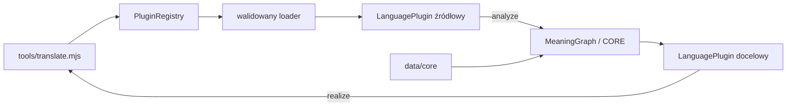

# Architektura flexLingua

## Przepływ tłumaczenia



CLI rozwiązuje pakiety przez registry. Plugin źródłowy analizuje zdanie do neutralnego znaczenia, a plugin docelowy realizuje to znaczenie w swoim zakresie. Wynik zawiera tekst albo jawną odmowę, CORE i diagnostykę. Obecność leksemu lub reguły w danych nie dowodzi obsługi całej konstrukcji.

## Własność warstw

```text
js/
  core/       wspólny Engine, MeaningGraph/CORE i interpretery
  plugins/    kontrakt, walidacja, registry, loader i LanguageGraph
languages/
  registry.json
  <code>/
    index.js manifest.json graph.json
    lexicon.json grammar.json features.json
    morphology.json morphology-lexicon.json signal.json provenance.json
data/
  core/       wspólna ontologia, cechy CORE i provenance
tools/
  translate.mjs
examples/
  cli-sentences.md
```

Dane języka poza `index.js`, `manifest.json` i `graph.json` są opcjonalne. Pakiet deklaruje tylko moduły, które istnieją i których używa. Registry i loader walidują pakiety przed udostępnieniem ich CLI.

## Granice semantyki i języka

- CORE przechowuje znaczenia i role, nie szyk zdania ani przypadek gramatyczny.
- LanguageGraph przechowuje typowane, ograniczone dane danego języka i ich powiązania.
- LanguagePlugin łączy graph oraz opcjonalne moduły ze wspólnym runtime; nie tworzy reguł osobno dla każdej pary języków.
- Manifest deklaruje status, kierunki i capability per operacja i konstrukcja. Deklaracja musi odpowiadać działającemu providerowi.
- Odmowa, wieloznaczność i utrata informacji są jawne. Brak modułu lub kierunku nie uruchamia starego fallbacku.
- Dane i licencje pozostają w provenance wspólnego CORE lub odpowiedniego pakietu.

## Aktualny zakres

Pakiety obsługują kontrolowane podzbiory PL↔EN i EN↔FI, kierunek TR→EN oraz kierunek IT→EN. AR jest pakietem morphology-only i odmawia tłumaczenia zdań. Szczegółowe kierunki i konstrukcje należy odczytywać z manifestów i weryfikować przez [CLI](cli.md).

Jedynym bieżącym sposobem ręcznej oceny tłumaczeń zdań jest Node CLI. Studio nie działa w obecnym CLI-only runtime; jego zasoby przeglądarkowe pozostają poza zakresem tego architektonicznego przepływu.
