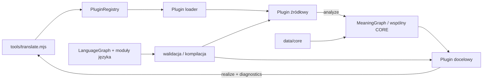

# Architektura flexLingua — pluginy językowe

## Docelowy przepływ



Plugin źródłowy odpowiada za odczyt form języka i mapowanie ich na neutralne
znaczenie. Plugin docelowy wybiera realizację zgodną z tym samym CORE. CLI
wyświetla wynik lub jawny refusal wraz z diagnostyką. Sam fakt, że graph zawiera
leksem lub feature, nie dowodzi, że pełne zdanie można analizować i realizować.

## Własność warstw

```text
js/
  core/       neutralny MeaningGraph/CORE, Engine i wspólne interpretery
  plugins/    kontrakt, walidacja, registry, loader, LanguageGraph i factory
languages/
  registry.json
  <code>/
    index.js manifest.json graph.json
    lexicon.json grammar.json features.json
    morphology.json morphology-lexicon.json signal.json provenance.json
data/
  core/       wspólna ontologia, cechy CORE i provenance
tools/
  translate.mjs
examples/
  cli-sentences.md  ręcznie redagowane zdania i kryteria przeglądu
```

`features.json`, `morphology.json`, `morphology-lexicon.json`, `signal.json` i
inne wyspecjalizowane dane są opcjonalne. Umieszcza się tylko moduły, które
plugin potrafi walidować i używać. Nie dodaje się pustego pliku jako deklaracji
wsparcia.

## Mapowanie obecnych zasobów

| Obecny zasób | Docelowe miejsce i właściciel |
| --- | --- |
| `data/concepts.json` | `data/core/concepts.json`, pojęcia wspólne |
| `data/features.json` | `data/core/features.json`, wyłącznie wspólne cechy znaczenia |
| `data/provenance.json` | `data/core/provenance.json` plus provenance każdego języka |
| `data/{en,pl,fi,tr,it}.json` | `languages/<code>/lexicon.json` |
| `data/grammar/{en,pl,fi,tr,it}.json` | `languages/<code>/grammar.json` |
| `data/morphology/{en,pl,fi}.json` | lokalny `morphology.json` odpowiedniego pluginu |
| `data/morphology/ar.json`, `ar-lexicon.json` | opcjonalny provider morphology-only w `languages/ar/` |
| `data/morphology/features.json` | lokalne profile form, bez globalnej unii morfologii |
| `data/languages/<code>.json` | `languages/<code>/manifest.json` |
| `js/languages/{en,pl,tr,it}.js` | `languages/<code>/index.js`; brak obecnego wrappera FI i sentence pluginu AR |
| `tools/review-sentences.mjs` | zastępuje je jedyne `tools/translate.mjs` |
| browser bootstrap/UI | wyłącza lub usuwa się w cleanupie CLI-only; nie jest runtime pluginów |
| `tests/` oraz automatyczne runner-y | usuwa się późno, po działającym CLI i ręcznym odbiorze |

W tabeli są obecne, główne rodziny danych, nie lista pojedynczych wierszy
leksykonu ani każdego importu. Każdy file move w zadaniu migracyjnym musi
uwzględniać wszystkie jego importy i zachować zawartość źródłową. Nie wolno
usuwać danych jako „testów”.

## Granice danych

- **CORE** zawiera neutralne koncepty, role, stany, zdarzenia, relacje i
  semantyczne wymiary. Nie zawiera szyku zdania, przypadku ani językowego
  wykładnika liczby.
- **LanguageGraph** zawiera typowane węzły/relacje dla konstrukcji, sensów,
  form i ich licencjonowanych powiązań. Schemat i zamknięte typy definiuje R04.
- **LanguagePlugin** łączy graph i istniejące moduły ze wspólnymi interpreterami.
  Nie implementuje osobnego algorytmu parsera per parę języków.
- **Manifest** identyfikuje wersję i deklarowane capability. Runtime ma je
  porównać z faktycznie dostępnymi providerami i nie może ogłaszać capability,
  której nie potrafi uruchomić.
- **CLI** ładuje pakiety przez registry. Po R07 to jedyna bieżąca ścieżka
  przeglądu tłumaczeń zdań.

## Rejestr i odmowy

Registry wybiera plugin po dokładnym kodzie i bezpiecznej ścieżce wewnątrz
repozytorium. Loader waliduje manifest, moduły oraz graph przed udostępnieniem
pluginu. Brak lub błąd provideru nie powoduje fallbacku do starego pliku.

`en` i `pl` mogą deklarować kontrolowany parsing/realization; `fi`, `tr` i `it`
mogą deklarować tylko piloty i zdania, które przeszły ręczny przegląd; `ar`
pozostaje morphology-only. Wszystkie pakiety muszą jawnie zwracać
`unsupported` dla nieobecnego kierunku lub konstrukcji. Nie wyciąga się
deklaracji kompletności z liczby leksemów ani CEFR.

## Kolejność wdrożenia

1. Przyjąć kontrakt i mapę własności (R01–R02).
2. Zbudować walidowany registry, loader, typowany LanguageGraph i declarative
   runtime (R03–R05).
3. Przepiąć wspólny Engine, feature profile, gramatykę, nominale, leksykon i
   morfologię bez compatibility adapterów (R06, R08–R09).
4. Uruchomić jedyne CLI i dopiero wtedy ręcznie przeglądać kontrolowane zdania
   per plugin (R07 i kolejne issues).
5. Po migracji klientów usunąć stare ścieżki, bootstrap GUI, tests/ i zbędne
   runner-y w osobnych cleanup issues; udokumentować aktualny stan.

Nie uruchamiamy starego `npm test`, gold runnerów, Actions ani GUI jako bramki
tego projektu. Przed CLI można wykonać lokalny przegląd składni i referencji,
ale nie przedstawia się go jako translacyjnego odbioru.
